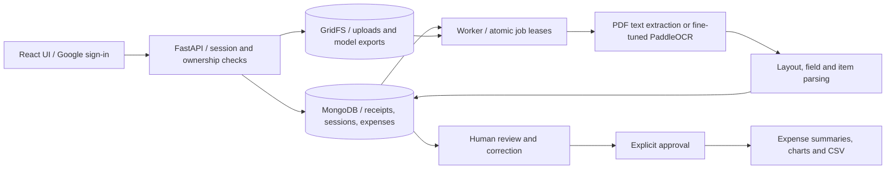

# SpendSense AI

Receipt images and PDFs become reviewed expenses, with merchant, date, currency, tax, total and line-item extraction. Users correct predictions, approve expenses, and explore spending by month, category and currency.

**[Live demo](https://spendsense-ivory.vercel.app)** · React / TypeScript · FastAPI · PaddleOCR · MongoDB

## Architecture



- The API queues extraction; the worker claims jobs with leases, bounded retries and heartbeats. Revision checks prevent late predictions from overwriting human edits.
- Selectable PDFs use text/table positions. Images and scanned PDFs use `PP-OCRv5_mobile_det` with a fine-tuned `en_PP-OCRv5_mobile_rec` recognizer.
- Google ID tokens are verified by the API. HttpOnly sessions, nonce/CSRF checks and owner-scoped queries isolate user data.
- Money is stored in integer minor units; analytics keep currencies separate. Only approved expenses enter analytics. Categories are manual and corrections do not automatically retrain the model.
- The hosted app uses Vercel web/API services and a Docker OCR daemon, backed by MongoDB Atlas and GridFS. Uploads are capped at 4 MB and five PDF pages.

## Decisions and rejected alternatives

| Choice | Alternative rejected or deferred | Trade-off accepted |
|---|---|---|
| Fine-tune an existing OCR recognizer | Serve the custom CNN + Transformer experiment | The custom model scored 0/457 validation fields; pretrained OCR supplies useful recognition, but layout rules remain necessary. |
| Separate OCR worker | Run OCR inside each HTTP request | Avoids tying API requests to model initialization and extraction; adds queue latency and an idle worker bill. |
| MongoDB job leases and GridFS | Add a separate queue broker and object store | Fewer services to operate; database load and storage grow together. |
| Human approval | Automatically book predicted expenses | Prevents unreviewed predictions entering analytics; requires user effort. |
| Manual categories | Claim an automatic category classifier | No validated category model is serving. |
| 4 MB upload cap | Direct uploads to separate blob storage | Simpler upload path; larger receipts must be reduced before uploading. |

## Failure cases

| Observed failure or limit | Current behavior / consequence |
|---|---|
| Fine-tuning regressed 13 previously correct test fields | Overall gains do not guarantee improvement on every receipt. All predictions require review. |
| A fictional sample's disclaimer was selected as its merchant | Users must correct the merchant even when date, total and currency are correct. |
| Ambiguous dates, currency symbols, faint text or irregular column gaps | Values can be missing or incorrect; item, real-receipt currency and category accuracy are unmeasured. |
| Worker unavailable or extraction fails | New uploads can fall back to manual review; queued work waits for recovery. Expired leases retry up to three attempts before manual review. |
| Worker finishes after a user edit | Revision and lease checks reject stale updates. |
| Similar layouts or public OCR pretraining overlap | Byte-level deduplication cannot establish truly unseen-layout accuracy. |

## Evaluation dataset and results

The local snapshots match [CORD-v1](https://huggingface.co/datasets/naver-clova-ix/cord-v1) and [ICDAR2019-SROIE](https://huggingface.co/datasets/jsdnrs/ICDAR2019-SROIE). CORD contributes total/tax labels; SROIE contributes merchant/date/total labels. Images and annotations are obtained from the upstream datasets under their respective terms, not bundled here.

Preparation produces **1,286 training, 225 validation and 461 test records**, using seed 42. SROIE training records are grouped by merchant for validation selection. Exact image-byte duplicates are removed from training/validation with test taking precedence; the test contains three duplicates, also reported separately below. Near-duplicate leakage remains unaudited.

The recognizer was fine-tuned on **40,268 receipt text crops plus 4,000 synthetic currency/amount examples**, for three epochs with batch size 8 and Adam/cosine decay at initial learning rate `2e-5`. Validation selected the checkpoint before test evaluation. The detector and field parser were held fixed for both models.

| Labeled-field accuracy | Pretrained | Fine-tuned |
|---|---:|---:|
| Validation, 225 receipts / 457 fields | 359/457 (78.56%) | 371/457 (81.18%) |
| Test, 461 records / 962 fields | 674/962 (70.06%) | **715/962 (74.32%)** |
| Deduplicated test, 458 images / 953 fields | 669/953 (70.20%) | **710/953 (74.50%)** |

There were **54 corrected fields and 13 regressions**, a net gain of 41. OCR execution errors were zero in both test runs. Accuracy counts only labeled or verified-absent fields, retaining failures in the denominator. Merchant matching normalizes whitespace/case; monetary values use decimal equivalence; dates use exact normalized values. This is field accuracy, not whole-receipt accuracy. Missing/noisy labels and unknown upstream pretraining overlap limit the conclusions.

Audit evidence: [evaluation and split metadata](reports/evaluation.json), [training provenance](reports/training-provenance.json), and [test image hashes and timing samples](reports/test-observations.csv). These contain no uploaded user receipts, credentials or receipt text.

## Latency and cost per task

**Historical OCR timings, not production end-to-end latency.** Each row covers 461 receipt images from the test run on 2026-11-02.

| Model | p50 | p95 | p99 |
|---|---:|---:|---:|
| Pretrained | 3.077 s | 7.292 s | 8.928 s |
| Fine-tuned | 3.167 s | 7.220 s | 8.828 s |

Both models ran concurrently on Windows CPU with two threads each and MKL-DNN. Runs resumed after a file-lock interruption, retaining completed samples. Timing includes image hashing/read, inference and conversion of predictions. It excludes model initialization, upload, queue wait, field parsing, database work, response delivery and human review. CPU model and competing load were not recorded. These numbers cannot establish a production latency guarantee or a model speed improvement. p50 is the median; p95/p99 use nearest rank.

**Production p50/p95/p99 and cost per completed extraction are not yet measured.** No billing export and matching task count are available. Cost must include idle daemon capacity and retries, even though OCR has no per-call model API charge.

```text
Cost per completed extraction =
  (worker + API + database/storage + network costs for the same period)
  / successfully completed receipt extractions in that period
```

Report training and human-review costs separately. To measure production latency, timestamp upload acceptance through availability of the review draft, split cold/warm requests, and record workload, sample count, failures and concurrency.

## Run the demo locally

Prerequisites: Git, Node.js 22+, uv and Python 3.11 (uv can install it). Commands below use PowerShell from the repository root. First OCR use downloads the public pretrained models. On Linux/macOS, use `ocr/.venv/bin/python` for `OCR_PYTHON` and equivalent shell environment syntax.

```powershell
git clone https://github.com/HarshitManhas/spendsense.git
cd spendsense
uv sync --frozen --python 3.11
uv sync --project ocr --frozen --python 3.11
npm ci
npm --prefix frontend ci
Copy-Item .env.example .env
```

Copy the example only for a fresh checkout. In `.env`, retain the local MongoDB URI and development login, and set:

```dotenv
EXTRACTION_PROVIDER=paddleocr
OCR_PYTHON=ocr/.venv/Scripts/python.exe
```

Leave `OCR_MODEL_ID` and `OCR_RECOGNITION_MODEL_DIR` unset to use public pretrained OCR. The evaluated fine-tuned weights are private and are **not included in this checkout**; the local baseline demo therefore does not reproduce the fine-tuned accuracy. Google login is optional locally; `GOOGLE_CLIENT_ID` enables it when its OAuth origin is configured.

Start each command in its own terminal, from the repository root:

```powershell
npm run db
uv run --frozen --python 3.11 uvicorn ai_expense_scanner.api:app --host 127.0.0.1 --port 8000
uv run --frozen --python 3.11 python -m ai_expense_scanner.worker
npm --prefix frontend run dev
```

Use an existing local MongoDB instead of `npm run db` if port 27017 is occupied. Generate a safe example with `uv run --frozen --python 3.11 python scripts/create_sample_receipt.py`. Open [localhost:5173](http://localhost:5173), select a development account, upload `data/demo/sample-receipt.png`, correct the merchant to **Sample Cafe**, check **2026-11-01 / INR 349.00**, choose a category and approve. Confirm that the expense appears in charts and CSV export. A second development account should not see it.

The [hosted demo](https://spendsense-ivory.vercel.app) requires Google sign-in. On 2026-11-05 the homepage and health endpoint returned HTTP 200 and the API reported `paddleocr_available`. Google authentication and receipt upload were not re-tested on the hosted site in that check.

## Reproduce evaluation and checks

Install the research extra with `uv sync --frozen --python 3.11 --extra ml`. Download snapshots with this Python snippet, running it through `uv run --frozen --python 3.11 --extra ml python`:

```python
from datasets import load_dataset
load_dataset("naver-clova-ix/cord-v1", revision="64fe41966657fbf60c1443a84143a2081dbd50a6").save_to_disk("data/cord")
load_dataset("jsdnrs/ICDAR2019-SROIE", revision="bffe40c26759f3376ec2b3ae9031dbba54cd587c").save_to_disk("data/sroie")
```

These revisions are from the local Hugging Face cache. Verify the generated manifest hash against `reports/evaluation.json` before comparing scores; the preparation audit also records the original split fingerprints.

```powershell
uv run --frozen --python 3.11 --extra ml spendsense-data
uv run --frozen --python 3.11 --extra ml python scripts/prepare_ocr_inputs.py --manifest data/manifests/test.jsonl --output artifacts/reproduce-inputs
ocr/.venv/Scripts/python.exe ocr/run.py --requests artifacts/reproduce-inputs/requests.jsonl --output artifacts/reproduce-baseline --threads 2
uv run --frozen --python 3.11 python -m ai_expense_scanner.ocr_evaluate --inputs artifacts/reproduce-inputs --run artifacts/reproduce-baseline
```

Use fresh output directories. The report includes field accuracy, failures, median/p95/p99 OCR timing and hashes. For a fine-tuned run, add `--recognition-model-dir` pointing to an exported recognizer and use a separate output directory. Exact fine-tuned reproduction requires the private weights or retraining; scripts for crop preparation, synthetic currency examples and training are under `scripts/`. Training provenance pins the upstream PaddleOCR commit and weight/dictionary hashes. The training script requires a GPU Paddle environment, upstream source in `.tools/PaddleOCR`, pretrained weights and Windows fonts; it is not a one-command portable training setup.

Recalculate the published timings without downloading images or models:

```python
import csv, math, statistics
with open("reports/test-observations.csv", newline="") as f:
    rows = list(csv.DictReader(f))
for model in ("baseline", "finetuned"):
    t = sorted(float(r[f"{model}_ocr_seconds"]) for r in rows)
    print(model, {"n": len(t), "p50": statistics.median(t),
                  "p95": t[math.ceil(.95 * len(t)) - 1],
                  "p99": t[math.ceil(.99 * len(t)) - 1]})
```

Run automated checks with local MongoDB available for integration tests:

```powershell
uv run --frozen --python 3.11 --extra ml pytest
npm --prefix frontend test
npm --prefix frontend run build
```

Integration tests create isolated temporary databases and skip if local MongoDB is unavailable. Never point `TEST_MONGODB_URI` at a production database. Datasets, private models, `.env` files and uploaded receipts remain excluded from Git.
