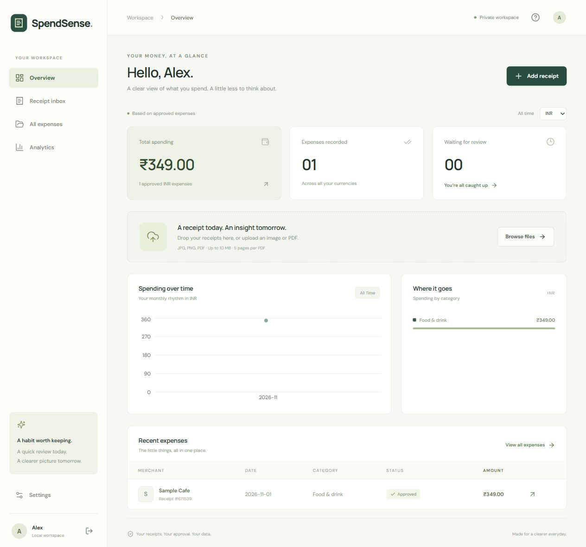

# SpendSense AI

A receipt-to-expense app built with **React, TypeScript, FastAPI, MongoDB/GridFS, and PaddleOCR**. Google sign-in keeps each user's receipts and expenses separate.

Upload an image or PDF, review the suggested fields and items, approve the expense, and see spending summaries update. Amounts in different currencies are never added together.



## Current implementation

- **Images and scanned PDFs:** local PaddleOCR detection and recognition, followed by receipt-field and item parsing. The evaluated receipt-trained recognizer is enabled in the development workspace.
- **Selectable PDFs:** direct text and table extraction preserves currency signs and column positions before falling back to OCR.
- **Review:** editable merchant, date, currency, tax, total, category, and item name/quantity/unit price/line total. Predictions require approval before contributing to analytics.
- **Storage:** MongoDB stores users, sessions, receipt drafts and approved expenses; GridFS stores original files and previews. The development workspace uses MongoDB Atlas. Firebase is not used.
- **Authentication:** Google Identity Services with server-side ID-token verification, nonce/CSRF checks and HttpOnly sessions. Receipt/file queries are scoped to the authenticated user.
- **Analytics:** approved expenses, category/month summaries, filters and CSV export. Money uses decimal validation and integer minor units.
- **Categories:** manual selection. A category-training pipeline exists, but no category model is trained or serving yet.
- **Custom CNN + Transformer:** research code is included; the full-receipt experiment failed validation and is not used by the app.

The trained weights, datasets, credentials, database files and generated artifacts are **not included in Git**. A fresh clone can use the original pretrained PaddleOCR models; using the fine-tuned model requires its exported files or a new training run.

## Run locally on Windows

Prerequisites: Python 3.11, [uv](https://docs.astral.sh/uv/), Node.js 22.12+ (tested with Node 24), and MongoDB locally or in Atlas. Run commands from the repository root.

```powershell
uv sync --extra ml
uv sync --project ocr --python 3.11
npm.cmd ci
npm.cmd --prefix frontend ci
if (-not (Test-Path .env)) { Copy-Item .env.example .env }
```

The main Python environment contains the API and PyTorch tooling. `ocr/.venv` isolates PaddleOCR 3.7.0 / PaddlePaddle 3.2.0 CPU inference from PyTorch. Initial setup/inference downloads public packages and model weights; receipt inference runs locally.

Set these values in the private root `.env`:

```dotenv
APP_ENV=development
MONGODB_URI=mongodb://127.0.0.1:27017
MONGODB_DATABASE=spendsense
FRONTEND_ORIGIN=http://localhost:5173
ALLOW_DEV_LOGIN=true
GOOGLE_CLIENT_ID=
EXTRACTION_PROVIDER=paddleocr
OCR_PYTHON=ocr/.venv/Scripts/python.exe
OCR_RUNNER=ocr/run.py
```

To use the evaluated fine-tuned export, add this setting **only when its files are present**:

```dotenv
OCR_RECOGNITION_MODEL_DIR=artifacts/paddle-finetune/run-v2/inference
```

That directory must contain `inference.json`, `inference.pdiparams` and `inference.yml`. An incomplete configured export is treated as unavailable, rather than silently replaced with the original model. Omit the setting to use pretrained OCR. Restart the API and worker after changing `.env`.

Start each service in a separate terminal:

| Service | Command |
|---|---|
| Local MongoDB, if not using Atlas | `npm.cmd run db` |
| API | `uv run uvicorn ai_expense_scanner.api:app --reload --reload-dir src --host 127.0.0.1 --port 8000` |
| Extraction worker | `uv run python -m ai_expense_scanner.worker` |
| Frontend | `npm.cmd --prefix frontend run dev` |

The local database helper downloads an official MongoDB binary on first use, binds to loopback, and persists data in ignored `.local-db/`. Alternatively, use `docker compose up -d mongo`; do not run both on the same port. Atlas users do not need either local database process.

Open [SpendSense](http://localhost:5173/) and [API documentation](http://127.0.0.1:8000/docs). Development accounts Alex and Sam have separate workspaces; they do not simulate Google identities.

Generate a fictional receipt for a workflow check:

```powershell
uv run python scripts/create_sample_receipt.py
```

Upload `data/demo/sample-receipt.png`. New image/scanned-PDF uploads use the configured recognizer. Existing receipts are not automatically reprocessed; use **Re-extract** on a draft when appropriate. Review all predictions before approval.

## Google sign-in

1. Create an OAuth **Web application** client in Google Cloud; configure branding, audience and test users as required.
2. Add `http://localhost` and `http://localhost:5173` as authorized JavaScript origins.
3. Put the public client ID in `.env` as `GOOGLE_CLIENT_ID=...apps.googleusercontent.com` and restart the API.
4. Reload the app and choose **Continue with Google**.

The current Google Identity Services popup/callback flow needs **no client secret and no redirect URI**. The server verifies the ID token's signature, audience, issuer, verified email and login nonce. Ownership uses the Google subject ID, not a user-supplied email.

Real Google login and Atlas session creation have been verified in the development workspace. Set `ALLOW_DEV_LOGIN=false` for Google-only login. Production requires `APP_ENV=production`, an HTTPS frontend origin and a configured client ID; development logins are rejected outside development.

Official references: [client setup](https://developers.google.com/identity/gsi/web/guides/get-google-api-clientid) and [server verification](https://developers.google.com/identity/gsi/web/guides/verify-google-id-token).

## MongoDB Atlas and file storage

Use an Atlas database user restricted to the application database, and configure the network access list for the application's connection. Keep credentials in ignored local environment files, never in frontend code or tracked documents.

To check a connection before replacing the active configuration, create a private `.env.atlas`:

```dotenv
MONGODB_URI=mongodb+srv://<database-user>:<db_password>@<cluster-host>/?retryWrites=true&w=majority
MONGODB_DATABASE=spendsense
ATLAS_PASSWORD='your database password'
```

The helper percent-encodes the password and rejects incomplete credentials or disabled TLS verification:

```powershell
uv run python scripts/connect_atlas.py
uv run python scripts/connect_atlas.py --apply
```

The first command checks authentication and a temporary write/read/delete probe. `--apply` changes `.env` only after verification and preserves the first previous configuration in `.env.before-atlas`. Restart the API and worker afterward. It does **not** migrate existing local receipts, files or sessions; the development workspace deliberately started with an empty Atlas database.

Collections: `users`, `sessions`, `receipts`, `receipt_files.files`, and `receipt_files.chunks`. Approved expense values are embedded in the receipt document. Original files and previews are delivered through authenticated API routes.

To finish file cleanup after an interrupted deletion:

```powershell
uv run python -m ai_expense_scanner.cleanup
```

This removes files for already-tombstoned receipts while retaining shared originals used by active pages. It does not delete active receipts.

## Datasets and fine-tuning

The local Hugging Face snapshots are expected at `data/cord` (CORD v1) and `data/sroie`. They are loaded with `datasets.load_from_disk`; they are not bundled in this repository. `download_dataset.py` downloads the SROIE snapshot if needed.

```powershell
uv run --extra ml spendsense-data
```

Prepared receipt splits are **1,286 training / 225 validation / 461 test**. Fifteen exact-image duplicates were excluded from training/validation; test records were retained. SROIE's training-to-validation split groups normalized merchant names. Test image hashes and IDs do not overlap this project's training or validation data. The test set contains three internal duplicates, so results are also reported for 458 unique images.

CORD supplies some totals, taxes and item annotations, but not merchant/date/currency labels. SROIE supplies merchant/date/total annotations, but not tax/currency/item labels. Neither dataset provides food/travel/etc. expense categories. Missing annotations are not treated as correct extracted values or zero amounts.

### PaddleOCR recognizer training

The completed experiment fine-tuned `en_PP-OCRv5_mobile_rec`; the detector stayed unchanged. Training used **40,268 real receipt-text crops plus 4,000 synthetic currency/amount lines** covering ₹, $, €, £ and ¥. Real crop labels came from annotations, not OCR pseudo-labels. Wide CORD column gaps were split, and exact crop duplicates were excluded across train/validation. Synthetic validation uses different font families.

Training runs in a third, isolated environment. The source is pinned to PaddleOCR `v3.7.0`, commit `b03f46425e8ff4442b268ce449e3eef758146cd4`:

```powershell
git clone --depth 1 --branch v3.7.0 https://github.com/PaddlePaddle/PaddleOCR.git .tools/PaddleOCR
uv venv .tools/paddle-training --python 3.11
uv pip install --python .tools/paddle-training/Scripts/python.exe -r ocr/training-requirements.txt --index https://pypi.org/simple --index https://www.paddlepaddle.org.cn/packages/stable/cu126/ --index-strategy unsafe-first-match
.venv/Scripts/python.exe scripts/prepare_paddle_finetune.py
.venv/Scripts/python.exe scripts/prepare_paddle_currency.py
```

Download the [official pretrained training weights](https://paddle-model-ecology.bj.bcebos.com/paddlex/official_pretrained_model/en_PP-OCRv5_mobile_rec_pretrained.pdparams) to `artifacts/paddle-finetune/pretrained/en_PP-OCRv5_mobile_rec_pretrained.pdparams`. The runner verifies SHA-256 `e25c9536f39791dfbd2f005f7e0fbbc2652d35b79bae999740059d93fec8e950` (70,070,474 bytes).

```powershell
.tools/paddle-training/Scripts/python.exe scripts/run_paddle_finetune.py --output artifacts/paddle-finetune/run-v2
```

Use a fresh output directory; existing datasets/runs are protected from overwrite. The command above is for a fresh installation. This workspace already contains `run-v2`. An optional `--baseline-run` can reuse a matching completed pretrained evaluation after settings/data/weight checks.

The run used three epochs, batch size 8, Adam/cosine decay with maximum learning rate 0.00002, 48×320 inputs, the original character dictionary, and modest augmentation on a 4 GB RTX 2050. Epoch 3 was selected using real validation crops. Paddle 3.2.2 emitted a cuDNN version warning in this Windows environment; GPU training, export and subsequent CPU inference nevertheless completed. Other hardware needs its own runtime verification.

The runner evaluates both recognizers, trains, selects the best checkpoint, evaluates the synthetic diagnostic, and exports `inference/`. It does not activate weights in the app automatically. Keep `status.json`, `config.yml`, `provenance.json`, logs, checkpoints and reports together under the ignored output directory.

### Evaluation results

Results from 2 November 2026 compare the original recognizer with the fine-tuned recognizer. Full-receipt evaluations keep the detector, image inputs, frozen field parser and normalization identical.

| Evaluation | Original | Fine-tuned |
|---|---:|---:|
| Validation: 225 receipts, 457 labeled fields | 359/457 (78.56%) | 371/457 (81.18%) |
| Held-out test: 461 records, 962 labeled fields | 674/962 (70.06%) | 715/962 (74.32%) |
| Deduplicated test: 458 images, 953 labeled fields | 669/953 (70.20%) | 710/953 (74.50%) |

On the full test set, **54 fields improved and 13 regressed**, for 41 additional correct values. Both models completed all 461 records with zero OCR failures. The paired receipt bootstrap on unique images gives an approximate 95% interval of **+2.70 to +5.97 percentage points** for the improvement (2,000 resamples; seed 42).

| Test field | Original correct | Fine-tuned correct |
|---|---:|---:|
| CORD total | 72/91 | 75/91 |
| CORD tax | 24/39 | 28/39 |
| SROIE merchant | 223/361 | 243/361 |
| SROIE date | 168/174 | 171/174 |
| SROIE total | 187/297 | 198/297 |

Separate text-crop exact accuracy, including case, spaces and punctuation, improved **61.12% → 88.54%**. Synthetic currency-text accuracy improved **67.36% → 99.31%**. The upstream Windows crop evaluator skips its final batch: these scores cover **8,184/8,194 real validation crops** and **576/600 synthetic samples**. The per-receipt evaluation processes every image and is not affected by that behavior.

These figures do **not** establish real-receipt currency accuracy, item-row accuracy, expense-category accuracy, or production latency. Public PaddleOCR pretraining overlap with CORD/SROIE is unknown; missing/noisy annotations and near duplicates remain limitations. The 81.18% validation result must not be presented as the held-out test result or expected customer accuracy. Human review remains necessary.

To reproduce a complete-receipt comparison with new output directories:

```powershell
.venv/Scripts/python.exe scripts/prepare_ocr_inputs.py --manifest data/manifests/test.jsonl --output artifacts/ocr/test-new
ocr/.venv/Scripts/python.exe ocr/run.py --requests artifacts/ocr/test-new/requests.jsonl --output artifacts/ocr/test-original-new --threads 2
ocr/.venv/Scripts/python.exe ocr/run.py --requests artifacts/ocr/test-new/requests.jsonl --output artifacts/ocr/test-trained-new --threads 2 --recognition-model-dir artifacts/paddle-finetune/run-v2/inference
.venv/Scripts/python.exe -m ai_expense_scanner.ocr_evaluate --inputs artifacts/ocr/test-new --run artifacts/ocr/test-original-new
.venv/Scripts/python.exe -m ai_expense_scanner.ocr_evaluate --inputs artifacts/ocr/test-new --run artifacts/ocr/test-trained-new
```

Use the validation manifest during development; reserve a new holdout for future changes now that this test set has been evaluated. The CLI's `--resume` only accepts matching inputs, settings, runner code and model hashes. Windows status-file replacement retries transient locks while preserving the previous file if retries fail.

Local evidence includes `artifacts/ocr/test/comparison.json`, the recovered test runs' `evaluation.json`/`predictions.jsonl`, and `artifacts/paddle-finetune/run-v2/receipt-comparison.json`. The test interrupted by Windows file locks was resumed from hash-verified cached predictions; the recognition settings, weights and field parser were unchanged. These generated files are not committed.

### App activation and rollback

The evaluated export is enabled in this development workspace through `OCR_RECOGNITION_MODEL_DIR`. A real upload through the frontend proxy and worker verified model fingerprint `document-layout-v2+currency-v2:5ed79ba5f37b9913`, `pending_review` status, date, total and currency. The fictional sample's merchant was misidentified, so this was a workflow/model-selection check, not a claim of perfect extraction. The test receipt was removed and no expense approved.

To return to the original pretrained recognizer, remove `OCR_RECOGNITION_MODEL_DIR` from `.env` and restart the API and worker. Review and approval remain required with either model.

### Items and expense categories

Item rules preserve multiword descriptions and separate column gaps. Users can correct item quantities/prices; mismatches require confirmation. Receipt totals remain authoritative because taxes, fees and discounts can differ from the sum of item rows. Bare shared currency symbols such as `$` or `¥` may remain unresolved without additional evidence.

```powershell
uv run python -m ai_expense_scanner.ml.prepare_details
uv run python -m ai_expense_scanner.ml.train_categories --labels data/private/category-labels.jsonl --output artifacts/categories/pilot
```

The category trainer requires verified examples: at least two categories, 20 distinct receipts and five merchants per category. This is a mechanical minimum, not a quality guarantee. It uses merchant/item text, holds out merchants, and refuses unverified/test examples. CORD's field categories are not expense categories. Settings can export the signed-in user's approved category examples; keep private exports separate by owner. No category model is installed automatically.

### Custom CNN + Transformer research

The PyTorch model and its training/evaluation pipeline remain available. An eight-receipt memorization experiment matched 18/18 known fields, but the full-data model produced repetitive outputs and scored **0/457 validation fields**. It is not the active OCR model, and limited-overfit checkpoints are rejected for app serving.

```powershell
uv run --extra ml spendsense-train --limit 2 --epochs 1 --batch-size 2 --height 64 --width 64 --max-length 256 --output artifacts/custom-smoke
uv run --extra ml spendsense-train --height 512 --width 256 --batch-size 2 --accumulate 2 --epochs 30 --supervise-unknowns --output artifacts/custom-full
uv run --extra ml python -m ai_expense_scanner.ml.evaluate --checkpoint artifacts/custom-full/best.pt --manifest data/manifests/validation.jsonl --output artifacts/custom-full/evaluation.json
```

These are research commands, not a recommendation to repeat the failed run unchanged. Text-recognition pretraining and better labeled data are needed. `--supervise-unknowns` teaches null abstentions for missing annotations, not proof that fields are absent. CUDA training supports mixed precision and epoch-boundary `--resume <run>/latest.pt`; preserve the original architecture and training settings when resuming. Checkpoints are never promoted automatically.

## Verification and maintenance

```powershell
uv run --extra ml pytest -q
npm.cmd --prefix frontend test
npm.cmd --prefix frontend run build
```

MongoDB integration tests create unique `spendsense_test_*` databases and remove only those fixtures. Start the local database helper before running them; otherwise they are skipped. Tests do not use the app's Atlas database by default.

Latest verification: **62 Python tests and 3 frontend tests passed**, and the TypeScript/Vite production build succeeded. Vite still reports a bundle-size advisory for the roughly 620 kB JavaScript bundle.

| Location | Purpose |
|---|---|
| `frontend/src/` | Upload, review, expenses, analytics and settings UI |
| `src/ai_expense_scanner/` | API, authentication, storage, parsing and worker |
| `src/ai_expense_scanner/ml/` | Custom-model/data/category research tools |
| `ocr/` | Isolated PaddleOCR runtime and training dependency pins |
| `scripts/` | Setup, dataset preparation, training and evaluation commands |
| `tests/` | Unit and MongoDB integration checks |
| `data/`, `artifacts/`, `.tools/` | Ignored datasets, local weights, evidence and training environments |

Before production, add rate limits and streaming request limits, improve worker monitoring/throughput, reconcile abandoned uploads, and implement account deletion, backups and retention. OCR currently reloads models per receipt and has a 180-second subprocess deadline; readiness is not a worker heartbeat. Production cookies/origins and real target-domain receipts need separate deployment testing.

This is a working development application with measured model limitations, not a production accuracy guarantee. Keep secrets and private receipt data out of Git.
