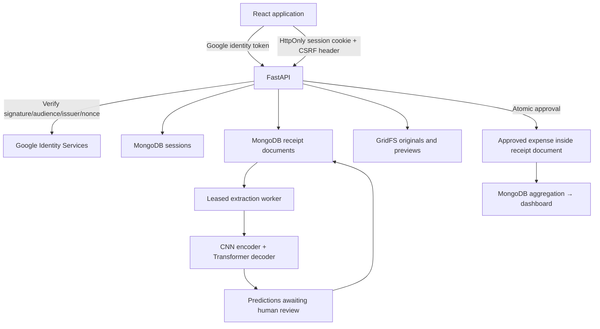

# SpendSense AI — MongoDB Implementation Plan

Updated: 2 November 2026 (Asia/Calcutta).

Currency/layout correction: native PDF text and table extraction, supported currency signs, seller/buyer separation, invoice-date priority, spacing-aware items and draft re-extraction are implemented. Symbol CNN experiments ran, but are not ready for serving. See [verification and training evidence](docs/currency-and-layout-fix.md).

Current extension: [merchant, date, items/prices and category training](docs/receipt-details-training-plan.md). Local OCR is now an app provider; item review and exact-price persistence are implemented. Enriched CORD/SROIE labels are prepared. Category training code is ready but verified expense-category labels are still required. The sections below retain the original custom-model architecture and experiment history.

The user requested MongoDB instead of Firebase during implementation. This is the current plan. The previous Firebase design is preserved in `docs/archive/SpendSense_AI_Firebase_Plan.md`; the supplied original project guide remains unchanged.

## 1. Product and workflow

Google sign-in → upload receipt image/PDF → selected extraction provider → human review of merchant/date/items/prices/category → explicit approval → MongoDB persistence → expense summaries and charts. Local pretrained OCR is the current usable provider; the custom CNN encoder + Transformer decoder remains a separate research path.

The application supports manual fallback when its selected provider is unavailable. Local OCR suggests values for review, including experimental item candidates. Category selection is manual until a separately evaluated category model is trained. This is a development build, not a production release.

## 2. Current architecture

| Layer | Implementation |
|---|---|
| Frontend | React 19, TypeScript, Vite, custom responsive CSS, Lucide, Recharts |
| API | FastAPI, Pydantic, Python 3.11, uv |
| Database | MongoDB through PyMongo |
| Receipt files | MongoDB GridFS: original uploads and rendered previews |
| Authentication | Google Identity Services ID token verified by google-auth; server-side sessions |
| Development accounts | Explicitly labeled Alex/Sam accounts, enabled only in development configuration |
| Extraction | Local PaddleOCR + field/item rules, or experimental custom CNN + Transformer; separate worker |
| Training data | Existing local CORD v1 and SROIE snapshots |
| Local database | Docker Compose or a downloaded official mongod run by the npm development helper |

No Firebase SDK, Firebase project, PostgreSQL server, or custom password database is required. Receipt data stays in the configured MongoDB instance.

## 3. Ownership, authentication, and sessions

Google's verified `sub`, prefixed with `google:`, is the stable owner ID. Email is display data. Browser requests cannot choose an owner. Every private receipt query and mutation includes the owner ID from the server session; previews and exports use the same boundary.

The server stores a hash of a random session token with a 12-hour expiration. The browser receives an HttpOnly, SameSite cookie (Secure outside development). Mutation endpoints validate both the configured Origin and a CSRF challenge. Google tokens are verified for the configured client ID and login nonce. Logout removes the server session; a database TTL index cleans up expired sessions.

`ALLOW_DEV_LOGIN=true` exposes only two named local test accounts. Configuration refuses to enable this outside development. Do not expose this local development server to the Internet. Production Google login requires a Google OAuth web client ID and approved JavaScript origins; no Firebase credentials or Google client secret are needed for the chosen GIS ID-token flow.

## 4. MongoDB data design

Collections:

- `users`: display metadata keyed by verified identity.
- `sessions`: hashed session IDs, owner profile, expiration with TTL index.
- `receipts`: owner, filename/upload/page references, lifecycle/revision, prediction, review fields, warnings, extraction lease, approved expense, recent audit events.
- `receipt_files.files` / `receipt_files.chunks`: GridFS binary data and owner metadata.

An approved expense is embedded in its receipt document. Approval is a single atomic compare-and-update, rather than separate receipt/expense writes that could diverge on a standalone MongoDB server. The expense ledger queries `ownerId` plus `status = approved`. Repeated identical approvals return the existing result; stale edits or conflicting approvals return HTTP 409.

Money is parsed with Python Decimal and stored as integer minor units, with an explicit currency exponent. The initial allowlist is INR, IDR, MYR, USD, EUR, GBP, and JPY. Unknown tax stays null. Currency is mandatory at approval; it is not inferred from dataset country. Currency totals remain separate.

Receipt dates are `YYYY-MM-DD` strings; audit timestamps are UTC. Category and notes are human-entered. History currently retains the latest 100 event summaries; full historical before/after value auditing remains a later milestone.

Deletion first tombstones a receipt so it immediately disappears from analytics, then deletes its page preview. A shared original PDF is removed only after all associated page receipts are deleted. A repeatable cleanup command handles interrupted deletion. Full account deletion, abandoned-upload reconciliation, and configurable retention still need implementation.

## 5. Upload, review, and inference

Supported files: JPG, PNG, unencrypted PDF. Initial limits: 10 MiB/file, 5 PDF pages, 25 million decoded image pixels, 25-second decoding subprocess deadline. Content is validated by decoding; supplied MIME types/extensions are not trusted.

Each PDF page produces a separate receipt draft. Multi-page receipt merging is not automatic. Originals are preserved; previews are bounded and normalized. Original and preview access remains private.

States: `queued`, `processing`, `pending_review`, `approved`, `rejected`, `failed`, `deleted`.

- Selected provider unavailable: create a clearly labeled manual-review draft.
- Selected provider installed: create a durable queued receipt. Run the separate worker. OCR is selected with `EXTRACTION_PROVIDER=paddleocr`.
- Worker: atomically claim a receipt, increment attempts, assign a lease token, render/model-infer/parse, and publish only if its lease token and revision still match.
- Review: persist editable fields without altering the original prediction.
- Approval: require merchant, valid date, amount, confirmed currency; tax remains optional.
- Invalid model JSON: keep a reviewable draft with warnings; never repair it by inventing amounts.
- Failure: retry or explicitly save a manual review.

The initial worker uses CPU inference, a ten-minute lease, and at most three claims. Add configurable inference deadlines, lease heartbeats, operational monitoring, and a model readiness manifest before production scaling. Tiny-overfit checkpoints are deliberately rejected by the serving worker.

## 6. Verified datasets and normalization

| Source | Original train | Original validation | Original test | Total |
|---|---:|---:|---:|---:|
| CORD v1 (`data/cord`) | 800 | 100 | 100 | 1,000 |
| SROIE (`data/sroie`) | 626 | — | 361 | 987 |

The local CORD metadata and all inspected training records identify v1, not the v2 linked by the original guide. Snapshots are loaded with `load_from_disk`; the implementation never redownloads them during preparation.

The preparation pass creates a deterministic merchant-group validation holdout from SROIE train and removes byte-identical image overlap from lower-priority partitions. Test takes precedence over validation, then train. **All 461 original test rows are retained**, including any within-test duplicates; those rows never enter vocabulary fitting. Near-duplicate/layout leakage still requires a separate audit.

Current generated manifests: **1,286 training / 225 validation / 461 test**; **15 training/validation records excluded** by exact image hash. Counts and fingerprints are stored in ignored `data/manifests/audit.json`.

| Field | SROIE | CORD |
|---|---|---|
| Merchant | `entities.company` | Unlabeled |
| Date | `entities.date`, with ambiguity checks | Unlabeled |
| Total | `entities.total` | `gt_parse.total.total_price` |
| Tax | Unlabeled | `gt_parse.sub_total.tax_price`, with structural checks |
| Currency | Unlabeled | Unlabeled |

Labels distinguish `labeled`, `verified_absent`, `unlabeled`, and `ambiguous`. Loss masks cover unlabeled/ambiguous JSON value spans, including placeholder nulls, so missing annotations are not taught as negative labels.

SROIE contains both day-first and month-first dates; unresolved dates such as `12-01-19` are excluded from date supervision. Two-digit years are accepted only for explicitly supported source years 17–19 and unambiguous day/month order. CORD uses mixed punctuation for monetary grouping. Its multi-section tax annotations are preserved for audit, not silently assumed to be full-receipt tax.

Before dataset-scale training: finish image corruption/layout audit, review normalization exclusions, add fully labeled synthetic or consented receipts (especially currency), record snapshot hashes/licenses, and establish a target-domain holdout. CORD/SROIE alone do not establish performance on Indian receipts.

## 7. Model and training

Implemented modules: `ml/data.py`, `prepare.py`, `vocabulary.py`, `model.py`, `train.py`, `evaluate.py`.

- CNN: four stride-2 convolution/GroupNorm/GELU blocks, final 128-channel grid.
- Visual tokens: projection plus row/column embeddings.
- Decoder: 256 dimensions, four heads, three layers, causal and padding masks, autoregressive character generation.
- Training: teacher forcing, padding and partial-label masking, AdamW, clipped gradients, seeded shuffling, validation loss, early stopping, CUDA mixed precision, gradient accumulation, and resumable epoch checkpoints with progress logs.
- Inference: greedy decoding bounded by EOS or maximum length; PAD/BOS suppressed as output.
- Evaluation: free generation, schema validity, EOS rate, per-source labeled-field accuracy, full-receipt denominator, artifact/manifest hashes.

Validation completed in this build includes shapes/gradients/causal masking, generation termination, and a two-image synthetic visual-discrimination overfit test. A one-epoch, two-real-receipt smoke run at 64×64 validates the data/training/checkpoint path. It is **not** a model-quality experiment or a usable extraction model.

CUDA execution is verified on the RTX 2050 using PyTorch 2.11/CUDA 12.8. The real-receipt overfit run used a deterministic eight-receipt subset alternating CORD and SROIE, at 512×256 resolution. The original unknown-value masking objective failed JSON generation; explicit null-abstention supervision passed with 8/8 valid outputs and 18/18 labeled fields correct. Unknowns still mean unavailable annotations, never zero or proven absence; the resulting dataset-specific abstention bias needs target-domain evaluation. Restart correctness is tested by comparing resumed and uninterrupted CPU optimization. Full-data training stopped after epoch 16; its best checkpoint generated valid JSON but matched 0/457 validation field values. See `docs/training-status.md`.

A separate pretrained PaddleOCR + field-rule baseline now matches 359/457 labeled values (78.6%) on the same 225 validation receipts. It uses an isolated CPU environment and preserves recognized text, geometry, scores, and field evidence. It is an alternative to the custom CNN + Transformer, not a successful training result for that model, and is not enabled in the app. See `docs/ocr-baseline-results.md` for per-field results and limitations, including unknown external OCR pretraining overlap and absent currency labels.

Remaining research: improve OCR merchant/tax selection and target-domain evaluation; pretrain text recognition for the custom CNN + Transformer; benchmark resolution, source balancing, confidence calibration, and free-generation checkpoint selection. Preserve the untouched test set until model selection is complete. Current custom checkpoint selection uses validation loss only and must be expanded before claiming extraction quality.

## 8. Built web features

- Responsive overview, receipt inbox, expenses, analytics, settings, and sign-in pages.
- Real MongoDB data and honest empty states; no fabricated spending history.
- Multiple upload selection; per-page PDFs; private preview and full-size viewing.
- Editable merchant/date/total/currency/tax/category/notes and item names/quantities/unit prices/line totals; save draft; approve/reject.
- Approved expense edits/deletion with revision checks.
- Date/category/currency filters and exact normalized merchant matching.
- Cursor pagination and full matching CSV export with formula-prefix protection.
- Currency-separated totals, monthly charts, category totals, pending-review count.
- Clearly separated local test accounts; Google GIS integration awaiting client configuration.

The current overview uses all-time totals. Planned month-to-date comparisons, timezone settings, full activity history, and account export/deletion are not presented as finished features.

## 9. Milestone status and next steps

| Milestone | Status | Remaining gate |
|---|---|---|
| Foundation | Built | Keep environment/configuration documentation current |
| Dataset adapters/manifests | Built, initial audit | Corruption/near-duplicate audit; normalization review; license record |
| Model correctness/training pipeline | Real overfit passed; full experiment failed extraction quality | Text-recognition pretraining and reliable held-out field extraction |
| Pretrained OCR baseline | Evaluated offline: 359/457 labeled fields correct | Merchant/tax improvements, target-domain evaluation, optional app integration |
| MongoDB persistence/local identity | Built and integration-tested | Production database identity, network policy, backup/restore |
| Google sign-in | Implemented, not live-verified | Configure Google client ID and test a real account |
| Manual receipt-to-analytics workflow | Built and integration-tested | Broader browser/accessibility coverage |
| Real AI extraction | Custom worker implemented; OCR alternative measured offline | Select a usable provider, integrate it with mandatory review, and test worker failures/readiness |
| Release hardening | Pending | Rate limits, streaming body cap, cleanup reconciliation, account deletion, deployment/monitoring |

Recommended next sequence:

1. Review this local application and decide any workflow changes.
2. Finish dataset quality/provenance checks and create a small fully annotated holdout.
3. CUDA setup is complete; profile memory and throughput for each larger experiment on the 4 GiB RTX 2050.
4. Completed: overfit eight real examples and inspect free-running output before long training.
5. Completed: evaluate the first full custom experiment and the separate OCR baseline without test-set tuning. Next, improve recognition/field selection and validate on fully annotated target-domain receipts.
6. Configure the Google client ID and, when needed, a MongoDB Atlas URI in ignored environment configuration.
7. Verify a genuine model-driven upload/review/approval flow; then address production hardening and deployment.

## 10. Acceptance and verification

Implemented automated checks cover date ambiguity, monetary normalization, partial labels, vocabulary escaping, model gradients/causality/EOS, synthetic overfit, money precision, production configuration guard, cross-user read/review/approval/preview/export access, concurrent repeat approval, edit conflicts, summary updates, invalid uploads, CSRF, logout, and shared PDF file cleanup.

The full product is done only when both conditions hold: the application workflow is reliable and secure, and the extraction model has documented measured quality with mandatory review. Passing application tests does not mean the model can read unseen receipts.

Run and configuration instructions are in `README.md`. The initial implementation status and known gaps are recorded in `docs/build-status.md`.
