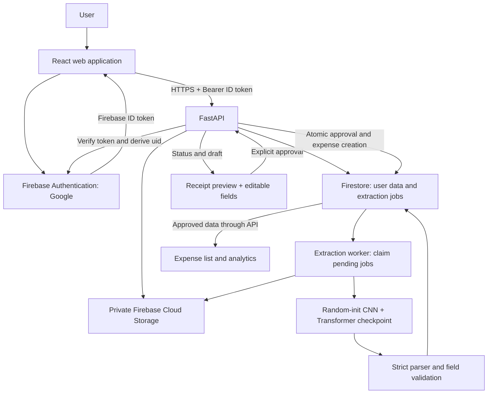

# SpendSense AI — Archived Firebase Plan

Superseded on 1 November 2026 when the user requested MongoDB in place of Firebase. See `../../SpendSense_AI_Project_Plan.md` for the current architecture and build status. Everything below is historical planning context, not the current implementation contract.

Prepared: 1 November 2026 (Asia/Kolkata)  
Status: planning complete; application and model implementation not started.

## 1. Project direction and scope

Build a personal expense application where a signed-in user uploads a receipt, receives AI predictions, reviews and corrects them, explicitly approves the expense, and sees their own spending dashboard update.

The requested flow is:

**Google sign-in → upload image/PDF → CNN encoder + Transformer decoder extraction → human review and correction → approval → save approved expense → refresh analytics.**

This plan uses the existing project guide as design context. Its embedded setup commands and “First coding task” are reference material, not instructions to execute during this planning task. The user's newer Firebase requirement replaces the guide's PostgreSQL architecture. This document plans implementation; it does not provision cloud resources, train a model, or change the original guide.

### Decisions

| Area | Planned decision |
|---|---|
| Product | SpendSense AI, a web application with separate private data for each Google account |
| Frontend | React + TypeScript + Vite; Tailwind CSS; Recharts |
| API | FastAPI + Pydantic |
| Authentication | Firebase Authentication with Google sign-in |
| Receipt files | Private Cloud Storage for Firebase bucket |
| Application database | Cloud Firestore, Standard edition |
| Model | PyTorch CNN encoder + autoregressive Transformer decoder |
| Initialization | Retain the guide's from-scratch model design; no pretrained encoder, OCR model, tokenizer, or hosted LLM in extraction |
| Training data | Existing local CORD v1 and SROIE snapshots, plus synthetic/consented data where needed |
| Writes and reads | Browser calls FastAPI for private application data; backend owns validation, authorization, and database writes |
| Approval | Required for every expense, including apparently correct predictions |
| Money | Decimal parsing in Python; integer minor units in Firestore; decimal strings at API boundaries |
| Local development | Existing Python 3.11/uv project plus Firebase emulators |
| Initial delivery | Working reviewed-expense workflow and an honestly evaluated experimental model |

Do not add PostgreSQL, SQLAlchemy, Alembic, custom password storage, or a second authentication system to this architecture.

### MVP and later scope

MVP: Google login/logout, JPG/PNG/PDF upload, extraction status, merchant/date/total/currency/tax review, approve/reject, expense editing/deletion, date/category/currency filters, exact merchant search, pagination, CSV export, and personal charts.

Category, payment method, and notes are user-entered metadata initially. Tax is optional. Currency must be confirmed when unknown. Line items, automatic categorization, foreign exchange conversion, shared accounts, bank integrations, arbitrary full-text search, and multi-page invoice merging are later features.

## 2. What is already in this repository

The following was verified locally during planning:

| Item | Current state | Planning consequence |
|---|---|---|
| `SpendSense_AI_Complete_Project_Guide.md` | Detailed original guide; PostgreSQL-based | Retain relevant model/review ideas; replace persistence/authentication design with this plan |
| `pyproject.toml` / `uv.lock` | Python package using uv; Python >=3.11; datasets, huggingface-hub, Pillow dependencies | Extend the existing package and lockfile; avoid creating a competing backend environment |
| `.python-version` | 3.11 | Use Python 3.11 as the initial tested runtime |
| `src/ai_expense_scanner/__init__.py` | Hello-world entry point | No API, model, or app logic implemented yet |
| `README.md` | Empty | Write setup, usage, dataset provenance, and limitations during implementation |
| `download_dataset.py` | Downloads SROIE and saves it using `save_to_disk` | Existing training should load local snapshots; later make downloads optional and versioned |
| `data/cord` | Hugging Face DatasetDict with Arrow files | Read directly; no need to redownload or convert all images to PNG |
| `data/sroie` | Hugging Face DatasetDict with Arrow files | Read directly; preserve original train/test split |
| `.gitignore` | Python/virtual-environment ignores only | Add datasets, secrets, checkpoints, build outputs, and emulator exports before committing |
| GPU | NVIDIA GeForce RTX 2050, 4,096 MiB VRAM reported by `nvidia-smi` | Start with small batches; benchmark memory before selecting training resolution |
| Git working tree | Existing project files are untracked | Preserve all existing content; do not bulk-stage large datasets |

The GPU inventory does not establish PyTorch/CUDA compatibility or training throughput. Validate both during the environment milestone.

### Verified dataset inventory

| Local folder | Identified snapshot | Train | Validation | Test | Total | Approximate disk use |
|---|---|---:|---:|---:|---:|---:|
| `data/cord` | Metadata says `cord-v1`; all 800 inspected training records have `meta.version = 1.0.0` | 800 | 100 | 100 | 1,000 | 2.159 GiB |
| `data/sroie` | `icdar2019-sroie`; downloader names `jsdnrs/ICDAR2019-SROIE` | 626 | — | 361 | 987 | 0.534 GiB |
| Combined | Two separate source datasets | 1,426 | 100 | 461 | 1,987 | 2.693 GiB |

CORD's precise original download revision is not recorded. Do not relabel this local snapshot as v2 or claim a verified Hub commit. Its local metadata and training annotations identify it as v1. Record local hashes and recover the source revision if available. The publisher describes v2 label corrections, so a future v2 experiment should use a separately versioned snapshot and comparison, not overwrite this baseline. See the [CORD release notes](https://github.com/clovaai/cord) and [CORD v1 dataset card](https://huggingface.co/datasets/naver-clova-ix/cord-v1).

Inspection loaded both DatasetDicts, counted splits, scanned training annotation coverage, and decoded the first three training images of each dataset. It did not inspect test annotations for model design, scan every image for corruption, run a leakage audit, or train/evaluate a model.

## 3. End-to-end architecture



Firebase stores identities, documents, and files. PyTorch inference runs in a Python process, not in the browser or inside Firestore. Training runs separately from the serving process.

Initially, use a continuously running worker with a Firestore-backed job queue. Keep the job interface replaceable if managed task delivery becomes useful later. Do not rely on an in-memory background task as the only record of accepted work.

### Workflow details

1. **Sign in:** Firebase signs the user in with Google. The frontend obtains a Firebase ID token and sends it as a Bearer token on API requests.
2. **Upload:** FastAPI authenticates, validates file content and limits, reserves an upload ID, and saves the original file privately. A durable record tracks partial upload failure and cleanup.
3. **Queue:** After successful storage, create page-level receipt drafts and extraction jobs. Return IDs and status using HTTP 202. Uploads and draft metadata exist before approval; only approved records appear in the expense ledger.
4. **Extract:** A worker claims a job, loads the versioned model, renders/preprocesses the image, generates structured output, validates it, and saves immutable prediction metadata.
5. **Review:** Display receipt and predictions together. Preserve the original prediction separately from editable review values. Missing or invalid fields remain visible.
6. **Approve:** Validate the latest reviewed values, enforce ownership and revision, and atomically create exactly one expense for that draft.
7. **Analytics:** Refetch the affected expense lists and dashboard after successful approval. Drafts, failures, and rejected receipts contribute no spending.
8. **Edit/delete:** Revalidate updates and refresh summaries; deletion excludes the expense immediately and schedules file cleanup according to retention settings.

### File and PDF policy

Initial configurable limits: 10 MiB per file, 5 PDF pages, 25 megapixels per decoded image, and a bounded render timeout. Verify actual bytes/content, not only extensions or supplied MIME types. Reject encrypted/unreadable PDFs and unsupported formats with a useful error. Normalize image orientation and use Pillow decompression limits.

For the MVP, a PDF is a batch with **one independently reviewable receipt per page**. The review screen must explain this assumption. Do not automatically sum pages or merge them into one expense. Users can reject cover/continuation pages. A single receipt spanning several pages requires manual consolidation and is outside automatic extraction scope.

Store upload and page IDs separately. Shared original PDF files are deleted only when no retained page record requires them, or when the complete upload/account is deleted. Never silently process just page 1.

## 4. Google authentication and user separation

Enable the Google provider in Firebase Authentication and configure the development and production authorized domains. Use the Firebase browser SDK's Google flow, with popup/redirect handling appropriate to the browser. The backend receives a **Firebase ID token**, not a Google API access token. See [Google sign-in](https://firebase.google.com/docs/auth/web/google-signin).

FastAPI verifies the token through Firebase Admin SDK and derives `uid` from verified claims. Reject missing, expired, invalid, and wrong-project tokens. Set a deliberate revocation/disabled-user policy, including revocation checks for account deletion. Default token verification alone does not check revocation. See [ID token verification](https://firebase.google.com/docs/auth/admin/verify-id-tokens).

Application ownership rules:

- Firebase `uid` is the stable owner identifier; email is display/profile data.
- Repository functions require the authenticated `uid`; no global expense lookup followed by optional filtering.
- Clients cannot select an owner by sending `userId`, email, object path, or a URL parameter.
- Scope uploads, previews, receipt status, review, approval, expenses, analytics, CSV export, jobs, and deletion to that UID.
- A guessed ID belonging to another account returns a non-disclosing not-found response.
- Clear query caches, previews, queued requests, and user state on logout/account change. Key frontend caches by UID.
- Let the Firebase SDK manage authentication persistence; do not manually copy tokens into localStorage. Use session persistence for the initial application.
- Store cloud credentials only on the server. Prefer workload identity/application default credentials in deployment.

**MVP access boundary:** Firestore and Storage client security rules deny all direct browser reads/writes. The browser uses the authenticated API for data and previews. The backend service identity receives only the cloud permissions it needs. Firebase server libraries bypass Firestore Security Rules, so backend authorization tests are essential. See [Firestore rules and server access](https://firebase.google.com/docs/firestore/security/rules-conditions).

Use authenticated preview endpoints rather than public receipt URLs. Return private/no-store cache controls and release preview object URLs on logout. A later direct-upload architecture would require a separate rules, path, and content-validation design.

## 5. Firebase storage model

### Firestore document paths

```text
users/{uid}
users/{uid}/uploads/{uploadId}
users/{uid}/receipts/{receiptId}
users/{uid}/receipts/{receiptId}/extractions/{extractionId}
users/{uid}/receipts/{receiptId}/reviews/{reviewId}
users/{uid}/expenses/{expenseId}
users/{uid}/expenses/{expenseId}/history/{eventId}
users/{uid}/jobs/{jobId}
```

| Document | Planned contents |
|---|---|
| User | Display name/email, timezone, preferred currency, training-consent flag, timestamps, schema version |
| Upload | Owner UID, original filename, generated storage key, MIME type, byte size, SHA-256, page count, upload/cleanup status |
| Receipt | Owner UID, upload ID, page index, preview key, lifecycle status, extraction/review revisions, editable draft, warnings, approved expense ID |
| Extraction | Model/preprocessing/vocabulary versions, parsed prediction, validation warnings, bounded output reference, latency, timestamp |
| Review | Before/after values, source extraction ID, changed fields, actor UID, revision, timestamp |
| Expense | Receipt/upload references, merchant, date, integer monetary values, currency, category, payment method, notes, approval metadata, revision, timestamps, deleted flag |
| Job | Owner/receipt references, desired model version, state, attempt count, lease token/expiry, heartbeat, next retry time, safe error code |
| History | Expense create/edit/delete event with revision and approved-value changes |

Keep large raw outputs in private object storage with bounded retention, not unbounded Firestore fields. Exclude notes, raw predictions, and other non-query fields from unnecessary indexes.

### Cloud Storage object layout

```text
users/{uid}/uploads/{uploadId}/original.{validatedExtension}
users/{uid}/uploads/{uploadId}/pages/{pageIndex}.png
users/{uid}/receipts/{receiptId}/extractions/{extractionId}.json
```

Training snapshots remain under local `data/`; they are not application users' uploads. Model checkpoints are separate protected deployment artifacts, with a manifest/checksum, not frontend assets.

### Monetary and date representation

Model/API draft example:

```json
{
  "merchant": "Example Store",
  "date": "2026-10-31",
  "total": "349.00",
  "currency": "INR",
  "tax": null
}
```

Approved Firestore expense example, omitting timestamps for readability:

```json
{
  "schemaVersion": 1,
  "ownerUid": "verified-firebase-uid",
  "receiptId": "server-generated-receipt-id",
  "merchant": "Example Store",
  "merchantSearch": "example store",
  "expenseDate": "2026-10-31",
  "totalMinor": 34900,
  "taxMinor": null,
  "currency": "INR",
  "currencyExponent": 2,
  "category": "uncategorized",
  "status": "approved",
  "deleted": false,
  "revision": 1
}
```

Use a vetted currency metadata table; do not assume every currency uses two decimal places. Parse with `Decimal`, reject unsupported precision instead of silently rounding, and bound integer values to backend/JavaScript-safe ranges. Firestore has integer and floating-point numeric types, so this project deliberately stores approved money as integers. See [Firestore data types](https://firebase.google.com/docs/firestore/manage-data/data-types).

Receipt dates are calendar dates (`YYYY-MM-DD`), not UTC midnight timestamps. Store audit events as server timestamps. User timezone determines “today” and month boundaries in the UI. Never add INR, IDR, and MYR into a single unlabeled total.

### State, atomic approval, and recovery

Receipt states:

```text
queued → processing → pending_review → approved
                    → failed
pending_review → rejected
failed → queued                  (explicit retry)
failed → pending_review          (explicit manual-entry fallback)
pending_review → queued          (explicit rerun with new revision)
```

An extraction containing invalid JSON can still produce a pending-review draft with null values and warnings. An infrastructure failure is `failed`; never disguise it as successful prediction. Manual-entry fallback must be labeled and recorded as manual. Approval does not rerun inference.

Use `expenseId = receiptId` for one expense per page draft. In a Firestore transaction, read the receipt and any existing expense, verify status/revision, create the expense, write review/audit records, and mark the receipt approved. Return an existing approved result for a repeated identical approval; return a conflict for stale or materially different requests. Use revisions for edits and worker writes too.

Firestore can retry transaction callbacks; keep storage uploads, model calls, and queue side effects outside them. Database changes can be atomic, but Storage and Firestore changes need explicit cleanup/retry handling. See [Firestore transactions](https://firebase.google.com/docs/firestore/manage-data/transactions).

The worker claims jobs transactionally with an expiring lease and generation/fencing token. Renew leases during long processing. Publish only if both the lease token and receipt extraction revision still match. Bound attempts, retain error codes, and recover expired jobs after restarts. A rejected, deleted, or superseded receipt must not be resurrected by a late worker.

## 6. Dataset preparation and labeling strategy

### Load the existing data

Use the saved DatasetDict format directly:

```python
from datasets import load_from_disk

cord = load_from_disk("data/cord")
sroie = load_from_disk("data/sroie")
```

`load_from_disk` is the matching API for datasets saved with `save_to_disk`. See the [Hugging Face datasets API](https://huggingface.co/docs/datasets/package_reference/main_classes#datasets.load_from_disk).

### Actual field coverage

The counts below are **raw training annotation candidates**, not validated ground truth counts or model accuracy.

| Target field | SROIE mapping and observed coverage, out of 626 | CORD v1 mapping and observed coverage, out of 800 |
|---|---|---|
| Merchant | `entities.company`: 626 nonempty | No merchant field in inspected semantic annotation categories |
| Date | `entities.date`: 626 nonempty; mixed formats | No date field in inspected semantic annotation categories |
| Total | `entities.total`: 625 nonempty | `gt_parse.total.total_price`: 781 present |
| Tax | No entity label | `gt_parse.sub_total.tax_price`: 355 candidates after dict/list handling |
| Currency | No entity label | No explicit currency field in inspected parsed schema |
| Address | 625 nonempty; outside MVP output | Outside MVP |
| Line items | Word/box annotations available | Menu labels available; defer full line-item extraction |

CORD training row 692 has `sub_total` as a list instead of an object. A dict-only adapter finds 354 tax candidates and misses this case. Handle both shapes, preserve provenance, and validate whether a candidate represents full-receipt tax. Do not assume any one candidate in a multi-section receipt is its overall tax.

Some CORD `valid_line` categories exist even when their `gt_parse` field is unavailable. Consider a fallback only after auditing line grouping and uniqueness; record its origin and ambiguity. Never pick cash tendered, change, or subtotal as the grand total merely because total is missing.

The published CORD release removed some store/payment information, which helps explain why it cannot alone supervise all requested fields. See the [publisher's CORD release history](https://github.com/clovaai/cord).

### Adapter and normalization rules

1. Build separate CORD and SROIE adapters, both producing the same field order: merchant, date, total, currency, tax.
2. Preserve raw annotation values, source dataset, source split/row key, snapshot fingerprint, and adapter version.
3. Record per-field label state: `labeled`, `verified_absent`, `unlabeled`, or `ambiguous`.
4. Trim/collapse merchant whitespace without inventing or correcting names from external knowledge.
5. Parse money with source-aware separator rules and `Decimal`. CORD has comma and dot conventions; ambiguous values go into an audit queue. Never globally strip all punctuation.
6. SROIE samples include `25/12/2018`, `12-01-19`, and `12/28/2017`. Do not use one unconditional day-first parser. Determine formats from unambiguous values and audited source/merchant patterns; quarantine unresolved day/month or century ambiguity.
7. Do not infer currency solely from dataset country. Keep it unknown unless supported by a verified image annotation; add explicit currency annotations/synthetic examples.
8. Missing tax is unknown, not zero. Never estimate tax as total minus subtotal when discounts/service charges can intervene.
9. Reject malformed annotation structures and report reasons. Keep excluded records and counts reproducible.
10. Audit decoded image dimensions, EXIF handling, corrupt files, duplicate hashes, and image-label pairing before training.

### Partial annotations need special treatment

An unlabeled merchant on a CORD receipt is not evidence that the receipt has no merchant. A missing tax label in SROIE is not proof that tax is zero or absent.

Keep nullable canonical targets, but mask loss over the complete value-token span for `unlabeled` and `ambiguous` fields, including placeholder `null` tokens. Continue supervising JSON structure and genuinely labeled values. Only supervise a null as a negative target when absence has been verified. Generate the span map during deterministic serialization and test it, including shifted targets and escaped text.

Masked placeholder values can still influence teacher-forced decoder context; measure the resulting behavior. Use fully annotated synthetic examples and a small, consented/manual full-field dataset to teach complete outputs and to evaluate cross-field behavior. If the model collapses to null predictions, investigate sampling and masking before increasing training duration. A field-conditioned training variant can be evaluated later without changing the public API.

Existing datasets do not supply reliable currency supervision. Currency prediction cannot be claimed validated until suitable labeled evaluation data exists. The UI must let users confirm it manually regardless.

### Splits and leakage control

- Keep CORD's 800/100/100 source split as the baseline.
- Preserve all 361 SROIE test records. Create a validation split from the 626 training records only, approximately 15% (about 94), leaving about 532 for training.
- Group SROIE training/validation by normalized merchant and duplicate/near-duplicate image groups where feasible. Exact counts depend on groups; record the resulting manifests, not just a seed.
- Before exclusions, this gives approximately 1,332 train / 194 validation / 461 test records.
- Audit overlap across original splits using image hashes and layout/merchant summaries. Quarantine contaminated training examples and report changed counts; do not tune on test performance.
- Fit learned vocabulary/statistics on final training records only. Add fixed JSON grammar and special tokens by design, not by reading held-out labels.
- Keep synthetic layouts/merchant groups separate across splits and report synthetic metrics separately from real receipts.
- Document benchmark-layout overlap where official splits share merchants; add a separate merchant-held-out evaluation if feasible, without silently replacing official results.

### Dataset deliverables

Planned files:

- `scripts/audit_datasets.py`: schema/coverage/corruption/duplicate report.
- `src/ai_expense_scanner/ml/adapters/{cord,sroie}.py`: source-specific normalization.
- `scripts/prepare_datasets.py`: deterministic manifests and exclusion logs.
- `data/manifests/{train,validation,test}.jsonl`: sample references, targets, label states, and provenance.
- `data/reports/dataset_audit.json`: counts before/after filtering and normalization issues.
- `docs/datasets.md`: provenance, versions/hashes, source links, attribution, split policy.

Manifests containing real labels should be ignored by default alongside data. Commit scripts and safe aggregate reports; do not accidentally publish receipt data.

CORD's local metadata declares CC BY 4.0. The SROIE snapshot's local license field is empty, while its [Hugging Face card](https://huggingface.co/datasets/jsdnrs/ICDAR2019-SROIE) lists CC BY 4.0. Capture upstream terms, attribution, and snapshot provenance before distribution; the mirror card alone should not erase that local provenance gap.

## 7. Model implementation and training plan

### Initial model

Use a custom CNN with four stride-2 convolution blocks, GroupNorm, and GELU. Project the feature grid to visual tokens and add 2D positional encoding. The Transformer decoder uses causal self-attention, cross-attention to visual memory, target padding masks, token embeddings, and 1D positions.

| Setting | Shape-test baseline | Training experiment |
|---|---|---|
| Image canvas (height × width) | 224 × 224 | Benchmark 512 × 256 with aspect-preserving padding first |
| Encoder downsampling | 16× | 16× initially; evaluate readability before further downsampling |
| Visual token count | 14 × 14 = 196 | 32 × 16 = 512 |
| CNN final channels | 128 | 128 initially |
| Decoder dimension | 256 | 256 initially |
| Heads / layers | 4 / 3 | Reduce only if profiling requires it |
| Feed-forward / dropout | 1,024 / 0.1 | Tune on validation only |
| Physical batch size | 1–2 for smoke test | Start 1–2 on the 4 GiB GPU; use gradient accumulation |
| Optimizer | AdamW | Start LR `3e-4`, weight decay `1e-4`, clip gradients at 1.0 |
| Generation | Greedy autoregressive | EOS or bounded max length; no silent truncation |

224 × 224 is a correctness baseline, not an assumed adequate receipt-reading resolution. Narrow, tall receipts lose detail when reduced. Inspect resized samples, then compare higher resolution or tiles if needed within the VRAM budget. Training/evaluation/serving must use identical deterministic resize/pad/normalize behavior apart from training-only augmentation.

Use character tokens learned from the training targets plus fixed syntax and `<PAD>`, `<BOS>`, `<EOS>`, `<UNK>`. Use `<BOS> + target` as decoder input and `target + <EOS>` as labels. Mask padding and unlabeled value spans. Choose maximum length from training target lengths plus a declared margin; count validation/test overflows instead of truncating silently.

### Experiment order and gates

1. **Model correctness:** Verify dimensions, finite logits/loss, finite nonzero gradients, causal masking, padding, field masking, vocabulary round-trip, and generation termination.
2. **Tiny overfit:** Overfit 8–16 clean training examples with augmentation off. Inspect free-running decoded fields as well as teacher-forced loss. Stop and debug if this fails.
3. **Readability and throughput:** Compare canvas sizes, record peak VRAM, samples/second, sequence length, and inference latency on the actual device.
4. **Synthetic pretraining experiment:** Render fully labeled receipts with varied fonts/layouts/noise and explicit currencies/taxes. All weights still start randomly. Keep template-held-out synthetic validation and real-only test reporting.
5. **Real-data training:** Mix SROIE merchant/date/total supervision with CORD totals/tax supervision using balanced sampling and field masks. Compare against a SROIE-only baseline to detect negative transfer.
6. **Validation:** Track free-running field metrics, parse rate, and missing/hallucinated fields. Select checkpoints using a documented validation score, with loss as a diagnostic.
7. **Final test:** Run once after choosing preprocessing, vocabulary, model, and decoding settings. Report each dataset and field separately.
8. **Package inference:** Version checkpoint, tokenizer, schema, preprocessing, adapter/split fingerprints, and evaluation report together.

Begin with a bounded run of up to 30 epochs plus early stopping, then decide from validation results. Do not promise convergence, accuracy, or training time from dataset size alone. Record seeds, hyperparameters, software versions, optimizer/scheduler state, and checkpoint checksums.

### Evaluation deliverable

Report JSON validity, per-field exact match, merchant normalized exact match and character error, date exact match, numeric amount exact match, known-field receipt exact match, missing/invalid/hallucinated values, and latency/VRAM. Include denominators and labeled coverage; unknown labels are excluded from accuracy denominators.

Do not report “all five fields correct” on a receipt without five verified field labels. Compute full-receipt accuracy on a fully annotated holdout only. Measure human correction rate on reviewed application examples, separately from model test accuracy. Never present token probabilities as calibrated field confidence.

A model card must state the dataset/language/layout limitations and measured results. The reviewed-expense application can be useful while extraction remains experimental; it must never present fixture data or manually entered values as model predictions.

## 8. API and UI contracts

All private endpoints require verified authentication. The server derives UID; public paths do not include a client-selected UID.

| Method and path | Responsibility |
|---|---|
| `GET /api/health` | Basic service health without sensitive details |
| `GET /api/me` | Authenticated profile and preferences |
| `PATCH /api/me` | Allowed profile/settings fields |
| `POST /api/receipts` | Validate upload, store it, create page drafts/jobs, return 202 |
| `GET /api/receipts` | Paginated review queue |
| `GET /api/receipts/{id}` | Status, prediction, review values, warnings, revision |
| `GET /api/receipts/{id}/preview` | Authorized page/image preview |
| `PATCH /api/receipts/{id}/review` | Save corrections with expected revision |
| `POST /api/receipts/{id}/extract` | Explicit retry/rerun; protect saved review changes |
| `POST /api/receipts/{id}/manual-review` | Explicit manual-entry fallback for failed extraction |
| `POST /api/receipts/{id}/approve` | Validate reviewed data and idempotently create expense |
| `POST /api/receipts/{id}/reject` | Reject draft with revision check |
| `DELETE /api/receipts/{id}` | Delete an unapproved draft and schedule safe cleanup |
| `GET /api/expenses` | Scoped filters, supported sort, cursor pagination |
| `GET /api/expenses/export.csv` | Export all matching records across pages |
| `GET /api/expenses/{id}` | Expense details and associated receipt reference |
| `PATCH /api/expenses/{id}` | Validate changes, record history, increment revision |
| `DELETE /api/expenses/{id}` | Exclude expense and schedule policy-based cleanup |
| `GET /api/analytics/summary` | Totals/counts by currency and selected date range |
| `GET /api/analytics/trends` | Monthly/category/merchant series |
| `DELETE /api/me` | Reauthenticated account/data deletion job |

Register static routes such as `export.csv` before an expense-ID catch-all. Define Pydantic/OpenAPI schemas and generate or synchronize frontend types. Return structured error codes, field errors, and request IDs. Use 401 for authentication failures, 404 for inaccessible records, 409 for revision conflicts, 413 for size limits, 422 for validation, and 503 for unavailable extraction dependencies.

Initial approval requirements: nonempty merchant, valid calendar date, nonnegative total, and supported confirmed currency. Tax may be null; a non-null tax must parse and be nonnegative. Warn on tax greater than total, future dates, and likely duplicate uploads; do not silently fix them. Allow an explicit recorded confirmation for business warnings where appropriate. Negative/refund expenses are a separate later contract.

### Screens

| Screen | Required behavior |
|---|---|
| Sign in | Google sign-in, loading/cancel/error states |
| Dashboard | Per-currency totals, month-to-date spend, pending reviews, recent expenses |
| Upload | Drag/drop/file picker, supported limits, progress, per-file failures and retry |
| Review queue | Processing/pending/failed/rejected state filters; page-level PDF entries |
| Receipt review | Zoomable preview, editable fields, original predictions, warnings, save/approve/reject |
| Expenses | Date/category/currency filters, exact merchant search, sort, cursor paging, CSV export |
| Expense details | Approved values, receipt preview, edit/delete, audit history |
| Analytics | Month/category/merchant charts with currency selection and clear empty states |
| Settings | Profile, timezone, display currency preference, optional training consent, deletion/export |

Polling uses bounded backoff and stops for terminal states or unmounted views. Prevent accidental overwriting of unsaved edits by a late extraction result. Disable repeated approval while submitting, while still relying on server idempotency. Require keyboard-accessible forms, visible labels, and loading/error/empty states.

## 9. Analytics and query design

The source of truth is the current user's non-deleted approved expenses. Review edits never affect analytics until approved. Editing/deleting an approved expense changes totals on the next refresh.

Start with server-side aggregation of a bounded date range, reading all matching pages rather than only the current UI page. Return currency-separated totals, expense count, monthly trend, category totals, and merchant totals. Return null/“not applicable” for percentage change when the prior period is zero. No currency conversion in the MVP.

Cache only by UID plus complete filter parameters and invalidate on approval/edit/delete. Initially the UI explicitly refetches after mutations and on window focus. If read volume grows, add per-user/month/currency materialized summaries, transactional delta updates, and a reconciliation job; do not maintain a second source of truth prematurely.

Plan Firestore indexes for the supported combinations of `deleted`, `expenseDate`, `currency`, `category`, `merchantSearch`, and a document-ID tie-breaker. Store these in `firestore.indexes.json` and verify them in staging. Use opaque, validated cursors bound to the filter/sort; avoid offset pagination. Restrict supported sort/filter combinations instead of offering unimplemented query combinations. See [Firestore queries](https://firebase.google.com/docs/firestore/query-data/queries).

Initial merchant search is exact normalized matching, clearly labeled in the UI. Broader prefix/full-text search is a separate design decision. CSV exports use the full matching result set, format decimal money correctly, and neutralize spreadsheet-formula cells beginning with dangerous formula prefixes.

## 10. Proposed repository structure

Preserve the current Python package and place the API/ML code beneath it. Paths below are planned unless already listed in the inventory.

```text
AI_expense_scanner/
├── SpendSense_AI_Project_Plan.md
├── SpendSense_AI_Complete_Project_Guide.md
├── README.md
├── pyproject.toml
├── uv.lock
├── .env.example
├── .gitignore
├── firebase.json
├── firestore.rules
├── firestore.indexes.json
├── storage.rules
├── docker-compose.yml
├── src/ai_expense_scanner/
│   ├── api/{main,dependencies}.py
│   ├── api/routes/{health,profile,receipts,expenses,analytics}.py
│   ├── core/{config,auth,logging}.py
│   ├── schemas/{receipt,expense,job,analytics}.py
│   ├── repositories/{users,uploads,receipts,expenses,jobs}.py
│   ├── services/{storage,pdf,extraction,review,approval,analytics,deletion}.py
│   ├── workers/extraction_worker.py
│   └── ml/
│       ├── adapters/{cord,sroie}.py
│       ├── {config,vocabulary,dataset,collate,preprocessing}.py
│       ├── {cnn_encoder,transformer_decoder,expense_model}.py
│       └── {train,evaluate,infer}.py
├── frontend/
│   └── src/{api,auth,components,pages,hooks,types,utils}/
├── scripts/{audit_datasets,prepare_datasets,generate_synthetic,reconcile_jobs}.py
├── tests/{data,ml,api,integration}/
├── frontend/tests/
├── firebase-tests/
├── data/
│   ├── cord/                    # existing snapshot, preserve
│   ├── sroie/                   # existing snapshot, preserve
│   ├── manifests/               # generated, ignored by default
│   ├── processed/               # generated, ignored
│   └── reports/
├── artifacts/                   # checkpoints/tokenizers, ignored
└── docs/{architecture,datasets,model_card,deployment}.md
```

Add Python dependency groups for API, training, and development as appropriate; retain uv as the dependency workflow. Pin a mutually compatible PyTorch/CUDA build after testing this GPU. Add `firebase-admin`, FastAPI, Pydantic settings, multipart support, PyMuPDF, PyTorch, pytest, and HTTPX as required. Keep frontend dependencies in its own package/lockfile. Do not change all existing dependency versions without checking compatibility.

## 11. Local setup and deployment plan

### Environment contract

Backend configuration: `APP_ENV`, `FIREBASE_PROJECT_ID`, `FIREBASE_STORAGE_BUCKET`, `FRONTEND_ORIGINS`, `MODEL_PATH`, `MODEL_MANIFEST_PATH`, upload/render limits, worker concurrency, and log level. Use application default credentials or a secure local credential path; never put service-account JSON in the frontend or repository.

Frontend configuration: Firebase web configuration (`VITE_FIREBASE_*`) and `VITE_API_BASE_URL`. Firebase web configuration identifies the project; it is not the server credential. Validate allowed origins and domains independently.

Local emulator configuration: explicitly gated `FIREBASE_AUTH_EMULATOR_HOST`, `FIRESTORE_EMULATOR_HOST`, and the storage emulator configuration supported by the installed Admin SDK. Fail production startup if emulator routing is enabled. Use a demo/test project and persist emulator data only in ignored development directories. The [Firebase Emulator Suite](https://firebase.google.com/docs/emulator-suite) supports local integration work; test actual Google OAuth separately in a real development Firebase project.

### Deployment stages

1. Local: frontend, FastAPI, one worker, and emulators; mocked extraction only in tests or an explicitly labeled development mode.
2. Development cloud project: Google sign-in, private bucket, Firestore rules/indexes, API and worker using restricted service identity.
3. Staging: exercise genuine model inference, two Google users, PDF upload, retries, restart recovery, and deletion.
4. Production/demo: built frontend on Firebase Hosting; containerized API and worker on suitable Python hosting. Initially prefer a small always-on VM/container host for the polling worker. Profile CPU inference before deciding whether GPU hosting is necessary.

Training uses the local GPU or a separately budgeted training machine; do not run training in the API container. Keep model weights loaded once per worker and bound concurrency to available memory. Health/readiness must distinguish “API up” from “model ready.” If no checkpoint is installed, expose extraction as unavailable and offer explicitly manual review, never fake predictions.

Cloud Storage for Firebase currently requires the Blaze billing plan; account for this before cloud provisioning. Configure budget alerts, quotas, upload limits, and retention. Alerts are notifications, not a guaranteed spending cap. See [Firebase Storage billing requirements](https://firebase.google.com/docs/storage/faqs-storage-changes-announced-sept-2024).

Choose a region near intended users and keep Firestore, Storage, and backend placement aligned where supported. Set final regions, retention periods, and hosting size during deployment setup after checking current availability and costs. This plan does not authorize a paid purchase.

## 12. Milestones, dependencies, and acceptance gates

Effort ranges are rough focused development days for one developer, excluding unattended training time, waiting for cloud setup, and research iterations. They are planning estimates, not delivery dates.

| Milestone | Work and concrete deliverables | Dependency | Exit condition | Effort |
|---|---|---|---|---|
| M0: Foundation | Extend package layout; ignore data/secrets/artifacts; configuration; README; schema/status/API decisions | This plan | Reproducible environment, preserved datasets, no private/large files staged | 1–2 days |
| M1: Dataset audit | Local adapters, label-state schema, normalization audit, validation split, manifests, provenance report | M0 | Exact usable counts, exclusions, leakage findings, and sample inspections documented | 2–4 days |
| M2: Model correctness | CNN/decoder/tokenizer/masking/preprocessing; shape tests; tiny overfit | M1 | Forward/backward and free-running tiny-set decoding work; actual VRAM measured | 2–4 days |
| M3: Firebase and identity | Emulators, Google auth integration, token dependency, repositories, deny-direct-access rules, two-user tests | M0 | User A cannot access any User B data/file through API or client SDK | 2–3 days |
| M4: Reviewed-expense slice | Upload/preview, draft editing, idempotent approval, expense CRUD, minimum React screens | M3 | Manual or explicitly labeled test flow persists exactly one expense and survives restart | 4–6 days |
| M5: Training and evaluation | Synthetic/full-field labels, real-data training, validation experiments, checkpoint bundle, model card | M2 | Reproducible artifact and honest per-field evaluation; unknown coverage declared | 4–8 days + research/compute |
| M6: Real extraction | Durable jobs, PDF page processing, model loading, parsing, UI status/retry, revision protection | M4 + M5 | Real image and PDF predictions flow into review; crash/retry cannot duplicate expenses | 3–5 days |
| M7: Expenses and analytics | Queries/indexes, filters/search, CSV, summary/charts, cache invalidation | M4; final checks after M6 | Approved data only; correct totals after edits/deletes; currencies separated | 2–4 days |
| M8: Release validation | Security/error/retention tests, Docker/setup, staging deployment, demo script, documentation | M6 + M7 | All critical end-to-end and isolation gates pass with real model artifact | 3–5 days |

Recommended execution: M0 → M1 → M2, then build M3/M4 while training experiments run, followed by M6/M7 and M8. The two workstreams share schemas and do not need separate agents. Roughly 23–41 focused development days are budgeted for engineering; from-scratch model quality may require substantially more experimentation/data.

### First implementation backlog

- [ ] Add `.gitignore` entries for local datasets, processed data, manifests with labels, checkpoints, `.env`, credentials, frontend builds, and emulator exports.
- [ ] Establish `docs/architecture.md`, schemas, field label states, and receipt/job state transitions.
- [ ] Add a repeatable dataset audit script matching the observations in this plan.
- [ ] Implement SROIE normalization, including mixed date formats and one missing total.
- [ ] Implement CORD dict/list adapters and ambiguous amount/tax handling.
- [ ] Freeze deterministic manifests and training-only vocabulary inputs.
- [ ] Implement model dimensions, causal/padding/partial-label tests, and tiny overfit.
- [ ] Add Firebase configuration, emulator setup, authentication dependency, and UID-scoped repositories.
- [ ] Build one receipt upload → review → approve → expense list flow before broad UI polish.

## 13. Verification plan

| Area | Required checks |
|---|---|
| Dataset | Local Arrow loading, schema mismatch, image-label alignment, dict/list CORD tax, missing total, mixed dates, ambiguous money, unknown versus absent labels, reproducible split, train/test leakage |
| Model | Shapes, gradients, causal masking, padding, exact supervised token spans, escaping/round-trip, tiny overfit, EOS/max length, train/infer preprocessing parity |
| Authentication | Missing/expired/wrong-project token; logout/account switch; revoked/disabled-user policy |
| Isolation | Two UIDs across read/list/edit/delete/review/approve/preview/export/analytics; forged owner fields; direct SDK access denied |
| Upload | Content mismatch, oversized image/file, corrupt/encrypted/oversized PDF, render timeout, partial Storage/Firestore failure |
| Jobs | Worker restart, lease expiry, duplicate delivery, retry exhaustion, stale revision/fencing token, deletion/rejection during inference |
| Approval | Required fields, invalid decimals/currency, double-click, concurrent approval, response-loss retry, stale review revision |
| Persistence | Files and expenses survive API/worker restart; emulator state restart when configured |
| Analytics | Draft exclusion, exact minor-unit arithmetic, independent currencies, date boundaries, pagination-independent totals, edits/deletes |
| Export | Complete result set, UID isolation, quoting, currency formatting, formula injection handling |
| UI | Keyboard controls, loading/error/empty states, unsaved edits, failed extraction/manual path, no cache leakage after account switch |
| Deployment | Real Google sign-in, current rules/indexes, HTTPS/CORS, secret handling, missing model readiness, bounded logs and request IDs |

Use pytest/HTTPX for API and dataset/model logic; Firebase rules tests and emulators for access boundaries; Vitest/React Testing Library for UI behavior; and a small Playwright end-to-end suite. Do not require long GPU training in normal CI. Run expensive overfit/evaluation experiments as explicit checks with saved reports.

Final scenario: User A signs in → uploads an image and a multi-page PDF → receives actual model predictions → corrects a field → approves → sees exactly one expense per approved draft and correct charts → edits/deletes → exports the remaining data. User B then signs in and cannot see A's receipts, values, previews, or charts. Restart the worker during extraction and repeat approval after a simulated network failure.

## 14. Risks and decisions to finalize during implementation

| Risk/decision | Planned response |
|---|---|
| 1,987 receipts are insufficient for robust from-scratch reading | Tiny overfit gate, synthetic data, focused field metrics, mandatory review, explicit experimental status |
| CORD v1 differs from guide's v2 reference | Preserve v1 baseline and hashes; compare a separately acquired v2 snapshot only as a later controlled experiment |
| Missing merchant/date/currency/tax supervision | Partial-label masking, full-field annotation/synthetic data, manual confirmation; no fabricated targets |
| Tiny text and 4 GiB GPU | Benchmark padded rectangular inputs, accumulation and mixed precision; profile before larger models |
| INR receipts may differ from training layouts/languages | Add consented target-domain holdout and training examples; do not claim Indian-receipt accuracy from CORD/SROIE alone |
| Firestore/Storage are not one atomic system | Upload lifecycle records, retryable cleanup, orphan reconciliation, transaction-only approval writes |
| Multi-user financial documents | UID-scoped repositories, private files, no direct client data access, tested cache clearing |
| Retention/deletion | Set explicit periods before deployment; delete Storage objects and Firestore subcollections with a retryable job; parent-document deletion alone is insufficient |
| User correction reuse | Off by default; require separate explicit consent, dataset provenance, and split checks; no automatic online retraining |
| Billing/hosting | Emulators first; establish cloud region, budget, service identity, and actual inference latency before selecting paid capacity |

Unresolved configuration values do not block the first implementation milestones: Firebase project ID/bucket, production domain, region, final hosting budget, retention periods, and model quality targets are not present in the repository. Keep placeholders until deployment setup and baseline evaluation. Do not place credentials in this plan.

## 15. Definition of done

- [ ] Google sign-in works and every private resource is isolated by Firebase UID.
- [ ] Images and PDFs are stored privately in Cloud Storage with validated limits.
- [ ] The installed CNN + Transformer checkpoint was trained from random initialization on documented data.
- [ ] Actual model predictions, versions, failures, and warnings are visible honestly.
- [ ] Users can review, correct, save, approve, or reject drafts.
- [ ] Approved expenses are persisted in Firestore exactly once per receipt draft.
- [ ] Approval/edit/delete refreshes expense views and correct currency-separated analytics.
- [ ] Supported filters, exact merchant search, pagination, and CSV export work across the full dataset.
- [ ] Worker restart, duplicate approval, and cross-user access tests pass.
- [ ] Dataset snapshots/splits, licenses/provenance, model evaluation, and known limitations are documented.
- [ ] Local setup is reproducible and staging validates the complete flow with two real Google users.

The application workflow and the model's measured quality are separate acceptance dimensions. A successful demo must complete the workflow and disclose extraction quality; it must not imply that completing the UI proves production-level receipt recognition.
